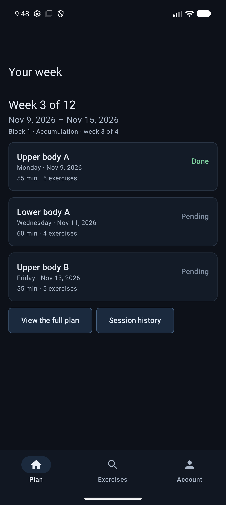
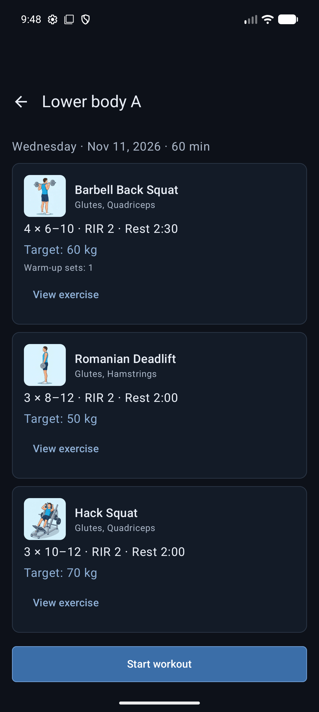
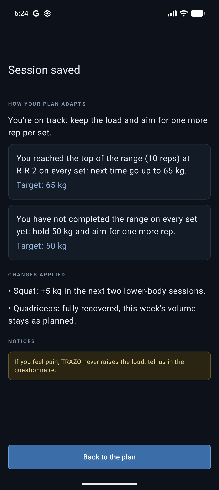
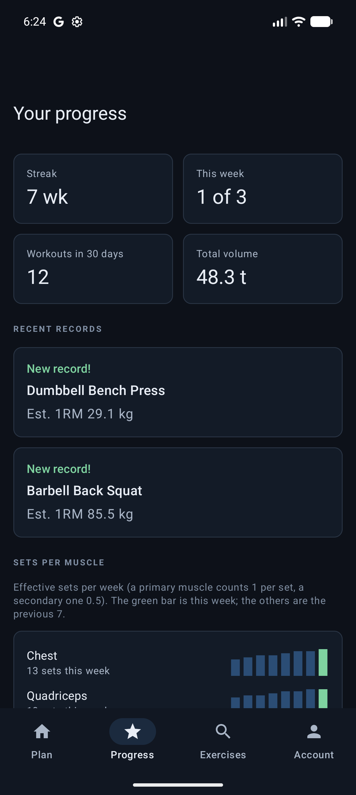

# TRAZO for Android

**A native strength-training app, backed by a training engine that adapts as you train.**

TRAZO helps lifters follow a structured programme, record each session and track progress over time. The Android app is the mobile client for the TRAZO platform; plan generation, progression rules and account entitlements are handled by the backend.

[Backend and administration repository](https://github.com/jl-hita/Trazo)

## In the app

<p align="center">
  
  
  
  
</p>

## What it does

- **Personalised plans.** A guided setup captures training goal, experience, weekly availability, session length, equipment and limitations. The server generates the programme and decides what comes next.
- **Structured training.** Macrocycle phases, training blocks, weekly schedules and exercise prescriptions are presented in the app.
- **Workout tracking.** Record sets, repetitions, loads, RIR and session feedback. Workouts can be logged for the day they actually took place, including previous days.
- **Progression and adaptation.** The backend uses training history and feedback to adjust upcoming loads, volume and intensity. The app displays those decisions and their context.
- **Exercise catalogue.** Browse and filter exercises, inspect details and replace an exercise with a suitable alternative.
- **Flexible scheduling.** Plans can use a calendar or rotate sessions in sequence, without fixed weekdays.
- **Account and communication.** Email/password and Google sign-in, email verification, password recovery, optional TOTP two-factor authentication, review requests and conversations.
- **Referrals and subscriptions.** Referral invitations and reward status, with Google Play Billing integration and subscription access controlled by the backend. Paid access enforcement is configurable and is off by default.
- **Notifications.** Firebase Cloud Messaging delivers review updates and announcements. Firebase configuration is supplied by the API at runtime.
- **Language support.** Spanish and English UI, with language negotiation and localised exercise and equipment details from the API.

## Technical overview

| Area | Implementation |
| --- | --- |
| Language | Kotlin |
| UI | Jetpack Compose, Material 3 |
| Networking | Retrofit, OkHttp |
| Async work | Kotlin Coroutines |
| Navigation | Navigation Compose |
| State and lifecycle | AndroidX Lifecycle |
| Authentication | Credential Manager, Google Identity, JWT |
| Local protection | Android Keystore-backed token storage |
| Push | Firebase Cloud Messaging |
| Distribution | Google Play App Bundle, R8 |
| Minimum Android version | Android 8.0 (API 26) |

The application uses a versioned REST API. The backend owns the training rules and validates subscription access; the Android client is responsible for interaction, local workout state and presenting the server's responses.

## Local development

### Requirements

- Android Studio with a compatible Android Gradle Plugin (the project currently uses AGP 9.2.1).
- JDK 17.
- Android SDK 36.
- The Gradle wrapper included in this repository.
- A reachable TRAZO API for authenticated and server-backed features.

Build the debug APK:

```bash
./gradlew --no-daemon :app:assembleDebug
```

Run unit tests:

```bash
./gradlew --no-daemon :app:testDebugUnitTest
```

### API endpoint

The debug build defaults to the Android emulator's host bridge:

```text
http://10.0.2.2:5001/
```

You can override the endpoint without changing source code:

```bash
./gradlew --no-daemon :app:assembleDebug \
  -PapiScheme=https \
  -PapiHost=your-api-host.example \
  -PapiPort=443
```

Or provide a complete base URL:

```bash
./gradlew --no-daemon :app:assembleDebug \
  -PapiBaseUrl=https://your-api-host.example/
```

Cleartext HTTP is restricted to debug builds. Release builds require HTTPS and must be compiled with the intended API endpoint.

### Google Sign-In

Configure a Web OAuth client ID as `googleWebClientId`:

```bash
./gradlew --no-daemon :app:assembleDebug \
  -PgoogleWebClientId=YOUR_WEB_CLIENT_ID.apps.googleusercontent.com
```

The backend must be configured with the matching client ID. Register the Android OAuth client for package `com.trazo.android` and the signing certificate fingerprints used by your builds. No Google client secret belongs in the APK.

See [configuration](docs/configuration.md) for the full setup.

## Reliability and data

Authentication tokens are stored using Android Keystore-backed protection. The app also keeps local workout drafts and pending records so an interrupted session is not immediately lost.

Local workout records are currently stored in the app's private storage as JSON; they do not have the same at-rest encryption as authentication tokens. Pending records are retried by the relevant app flows, but background synchronisation is not yet a guaranteed WorkManager-backed service. These are important distinctions when evaluating the current offline behaviour.

Unexpected crashes and unreadable API failures can be reported to the backend's error-ticket system. Release builds upload their R8 mapping file when the CI secret is configured, allowing supported crash traces to be de-obfuscated for investigation.

## Tests and delivery

GitHub Actions runs the Android unit-test task and assembles the debug application. The project also has a separate release workflow for release artefacts and diagnostic mapping upload.

These checks are useful regression safeguards, but they are not a substitute for testing the complete experience on a physical device.

## Related documentation

- [Build and configuration](docs/configuration.md)
- [Release process](docs/release.md)
- [Backend architecture and training engine](https://github.com/jl-hita/Trazo/tree/main/docs)

---

The Android client is under active development alongside the [TRAZO backend](https://github.com/jl-hita/Trazo).
